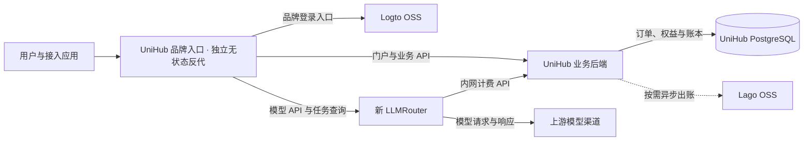
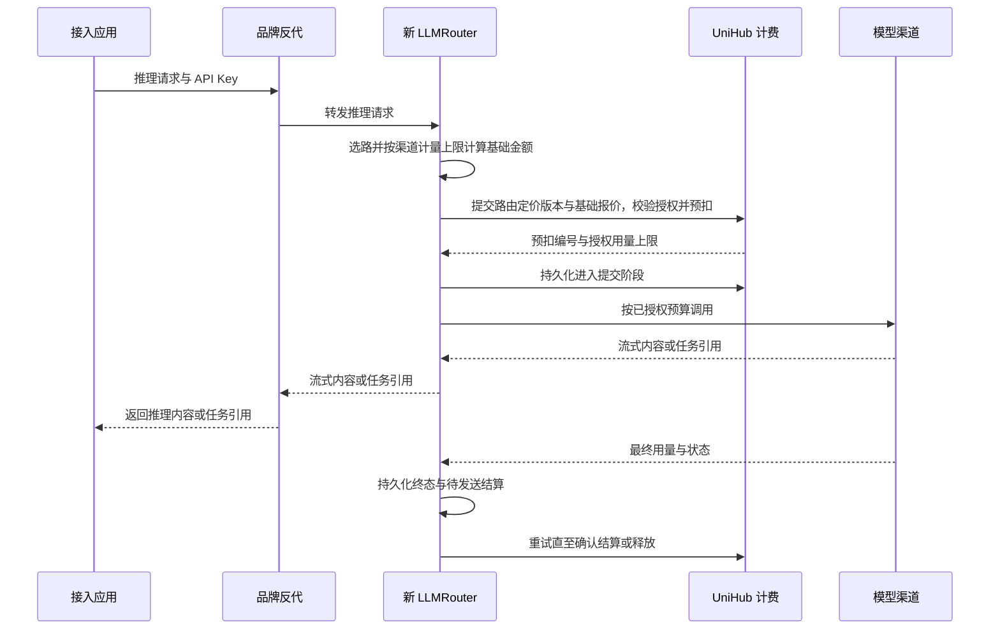

# UniHub 开源集成实施方案

UniHub 是用户和接入应用的统一入口，提供登录、应用接入、充值、会员与积分、模型目录、API Key 和交易明细。**UniHub 管业务账户、权益和一本账。Logto OSS 管身份，新 LLMRouter 管推理，Lago OSS 按需提供企业账单。** 首期直接用 UniHub 生成订单明细和收款凭证。

## 模块职责与访问路径



| 模块 | 实现边界 |
| --- | --- |
| UniHub | 控制面。首期用一个业务后端和 PostgreSQL 管应用登记、账户、商品、订单、现金和积分账本，提供门户、业务 API、Key 管理和内网计费 API。 |
| Logto OSS | 国内、美区各自部署一套。通过本区 UniHub 品牌 HTTPS 入口提供标准 OIDC。UniHub 用 `issuer + sub` 绑定内部用户 ID，校验业务角色和会话。 |
| 新 LLMRouter | 模型数据面和第一层定价。为接入应用提供统一 Key、协议与路由，采集渠道实际用量，按官方计量规则和渠道或模型倍率换算基础金额。管理控制台和内部接口走运维网络。 |
| Lago OSS | 保留现有部署用于评估。企业确实需要标准 PDF、复杂计价或周期后付费时，先用开源版样张验证，再由 UniHub 异步同步已确认交易或单独的后付费用量。 |

品牌反代独立运行，把 `/v1/models`、推理、流式 SSE、媒体、向量、重排序、OCR 及异步任务路由到 LLMRouter。门户与账户、商品、钱包和 Key 管理走 UniHub 业务进程。**门户与 `/v1/models` 共用 UniHub 的目录解析**。网关验 Key 后，用绑定的应用、付款账户与账区向 UniHub 请求已过滤目录。UniHub 将按应用、账户类型、地区发布的模型和用户当前权益，与 LLMRouter 实际启用且可计量的路由求交集。新预扣执行相同的资格检查。UniHub 重启期间，网关继续传输已授权预算内的在途响应并持久化待结算消息。新目录请求与预扣需要 UniHub 可用，故障时返回可重试错误。



## 应用商品设置

配置入口放在 **「UniHub 运营后台 → 应用管理 → 选定应用 → 商品与计费」**。具有该应用商品管理权限的运营人员维护个人版和企业版商品卡，可以调整卡片数量、名称、权益描述和数值参数。用户从接入应用跳转，或在 **「UniHub 门户 → 我的应用 → 选定应用 → 会员与积分」** 查看当前付款账户可购买的已发布商品。

| 商品与规则 | 个人账户 | 企业账户 |
| --- | --- | --- |
| 会员 | 档位、账期、价格、每周期基础与赠送积分、有效期、续费及档位转换配置。 | 同一字段集，价格与积分按席位配置，另有增减席、换档及共享池规则。 |
| 积分包 | 价格、到账积分、有效期、购买资格，积分发给个人账户的应用池。 | 同一字段集，积分发到企业的应用共享池。 |
| 模型售价 | 模型可见性、地区、允许路由及其固定的网关计量和基础费率版本、UniHub 溢价或折扣、金额换积分比例及生效时间。 | 可配置单独的企业售价。预扣额外核对应用席位、企业共享池和成员周期余量。 |

商品和 UniHub 售价按应用、账户类型与服务地区发布。已发布版本不可修改，以新的生效版本替换。同一范围和生效时刻只允许一个发布版本，按指定时间解析最近已生效的版本，并提供按 ID 回读快照。已确认订单引用并保存商品和价格快照。模型调用使用已授权尝试的两层费率与兑换版本。**[拟议默认]** 售价首期按应用、账户类型、地区及模型配置，目录可见性可随可读权益键过滤。会员档位独立定价维度待产品确认。首期同一付款账户的现金可用于本服各应用的商品，积分按应用使用，企业共享池按企业和应用归属。

网关将官方单价、倍率或计量变化存为新的定价版本。UniHub 发布售价时，为每条允许路由固定其 `meter_version` 与 `router_rate_version`，并固定本区币种与积分换算。网关仅用目录返回的版本对新请求报价，UniHub 拒绝未发布版本、错误计量版本或不符合已发布价格规则的报价。网关管理员的改价要等相应 UniHub 版本生效后才影响用户。下线和故障可以先关闭受影响的路由，历史版本保留供结算和对账。

**[拟议默认]** 同模型多路由在门户列出单位与适用条件。单位和规格一致时也可显示价格区间，跨单位显示分项价格。预扣前按选中路由确定本次报价与积分上限，自动切换不能抬高用户已接受的上限。**[待产品确认]** 目录采用区间还是默认路由价、何时在 UI 明确展示本次最高应扣，及是否允许用户重新授权更高报价。

### 按应用分配席位

**[拟议默认]** 企业成员关系仍属于企业。付费席位在 `account_id + app_id + subscription_id` 下分配给成员。同一个订阅对同一成员仅分配一次，分配与释放同事务校验同一订阅的已购数量，并发操作也不能超配。新购买权限、领 Key 和预扣按目标应用检查。获授权企业所有者或管理员可在无席位时购买首批席位。普通成员购买及所有企业成员领 Key 或消费需持有该应用有效席位。只撤销应用 A 的席位时，应用 B 的席位独立生效。

阶段一的企业级 `has_seat` 已用于本地资格验证。阶段 2a 定义未来的关联与查询契约，2b 实现随订单生效的席位和分配约束，2c 验收商品规则，3 接入真实 Key 和预扣校验。**[拟议默认]** 旧 `has_seat` 不自动换成已购应用席位。以可核对的订单与应用归属迁移有凭据的分配，其余由企业管理员按应用分配。

## 统一订阅和付费规则

前期调研的 WorkBuddy 订阅和付费逻辑由 UniHub 统一实现。**SuperWagie 发布第一套商品配置**，后续接入应用沿用同一套订阅、升级、积分发放和扣减流程，通过各自的商品卡和费率参数体现差异。UniHub 按订单和调用所绑定的应用、账户类型与版本读取参数。

- **个人会员。** 支持月付、年付和经授权的自动续费，按月发放套餐积分。升级支付确认后开启新周期，按下文的统一公式折算旧套餐并退回原现金钱包。[WorkBuddy 套餐管理](https://www.workbuddy.cn/docs/workbuddy/Plan)
- **企业会员。** 企业按已购席位数订阅，管理员分配席位。每月按席位数向该企业在对应应用的共享积分池发放积分。管理员可设置成员周期消费上限，授权成员从企业池消费。[WorkBuddy 企业版计费概述](https://www.workbuddy.cn/docs/enterprise/215235277197647872)
- **积分包和消费。** 符合购买条件的个人或企业可一次性购买积分包。支付后生效并单独计算有效期。模型使用按实际用量扣积分，优先扣最早到期的批次。[WorkBuddy 积分说明](https://www.workbuddy.cn/docs/workbuddy/Credits) · [WorkBuddy 企业版计费说明](https://cloud.tencent.com/document/product/1831/134334)

SuperWagie 在商品发布时配置各区的档位售价、席位价格、积分数量和积分包规格。同一套字段供其他接入应用配置。

### 商品版本要表达的规则

以下为**[拟议默认]**，是首套商品配置的评审起点。档位、数值、可购范围与对客规则在商品发布前确认。若某应用需要功能级控制，配置可供应用查询的稳定权益键与取值，并同时维护面向用户的权益文案。

| 版本字段 | 拟议首发规则 |
| --- | --- |
| 稳定档位 ID、档位排序、月付/年付、允许的档位与账期转换 | 向更高档或同档月转年时，付款确认即开启新周期，并按已明确的个人升级公式折算。降档或同档年转月在当前周期结束后生效。 |
| 基础和赠送积分数量、发放周期、有效期和结转策略 | 随订阅的月度发放周期到期，首发不结转。基础与赠送批次分别记账，独立加量包沿用其购买时的到期日。 |
| 积分包购买资格、价格、额度、有效期 | 配置是否要求有效会员及可用档位门槛，SuperWagie 首发拟要求同应用有效会员。 |
| 自动续费开关、价格策略、余额不足策略 | 经单独授权从 UniHub 现金钱包续费，按续费时的生效商品价报价和通知。余额不足时提示充值，当前权益保留到已支付周期结束，不发下一期积分。取消自动续费时已有权益保留至到期。**[待产品确认]** 涨价重新授权及提醒时间。 |
| 企业增减席与换档策略 | 增席对齐原订阅到期日，按当前发放周期的剩余时长及后续完整周期计算补差，当前期按同一比例补发当期积分；后续按新席位数发放。减席与换档首发在续费边界生效。**[待产品确认]** 账期日界、取整及换档例外。 [WorkBuddy Enterprise 扩容说明](https://cloud.tencent.com/document/product/1831/134337) |

### 个人套餐升级折算

会员、席位和积分包统一由 UniHub 钱包支付。升级时从当前订阅的原付款钱包扣新套餐全价，报价展示新价格、预计返还与净支出。旧套餐返还汇入同一个个人或企业现金钱包。支付渠道对应的是原充值订单的退款与冲正。

以当前生效的旧订单实际支付金额为基准，价格按覆盖的发放月份平均分摊到最小币种单位，除不尽的余数依时间顺序分给前几期。`P` 是升级时旧当期分摊金额，`B` 是旧当期发放的基础积分，`U` 是最终由该批基础积分支付的用量。`F` 是旧订单所有未开始月份的分摊金额之和。截止升级时已结束的月份和赠送积分均无返还价值，独立积分包的消费和余额不计入公式。`C` 是旧订单实付减去其他退款后的非负额度，本次升级的分次返还计入该额度。

```text
最终累计返还 = min(C, F + floor(P × max(0, B - U) / B))
B 为 0 时，当期返还为 0，仅计入 F。
追加返还 = max(0, 最终累计返还 - 本次升级已返还金额)
```

升级以账户、应用和订阅版本串行提交。新套餐生效后，旧套餐基础和赠送批次停止新预扣，独立积分包保有原余额及到期日。已有预扣继续从原批次结算。先返还升级时已确认未占用的基础积分对应金额和 `F`。旧预扣全部终结后，以最终 `U` 重算累计返还，补付差额。旧套餐剩余积分作废，旧预扣释放的积分进入过期或回收记录。连续升级 A → B → C 时，B → C 只以 B 本次实际支付的订单为基准。每笔返还关联对应旧订单和唯一升级记录，历史返还计入该订单的金额上限。

| SuperWagie 样例 | 返还 |
| --- | --- |
| ¥99 月付，2,000 基础积分全部已用，周期仍剩一半。 | ¥0。无未开始月份，当期返还按基础积分计算。 |
| ¥672 年付，已结束一月，当月 2,000 基础积分用 1,000，未来有 10 个月。 | ¥588，含当期 ¥28 和未来 ¥560。 |
| A 实付 ¥99，先用完临期积分包，A 的基础积分未用。升 B 实付 ¥199。若同日 B 基础积分已用四分之一，再升 C 实付 ¥399。 | A → B 返 ¥99，B → C 返 ¥149.25，各退回原钱包。独立积分包按实际消费记账，A 的返还仅记一次。 |

## 充值入口

- **门户主入口为「钱包 → 充值」。** 「钱包」放在 UniHub 的一级导航。用户从顶栏选择个人或企业账户，钱包顶部的余额卡显示当前账户名、可用现金余额和本服币种，余额卡右上角放「充值」按钮。企业账户由具备充值权限的成员操作。
- **结账时从「余额不足，去充值」进入同一充值页。** 用户先选会员、席位或积分包，再确认付款账户。现金不足时，保留原购买项和付款账户。充值到账后回到原结账确认页，显示更新后的余额，由用户确认购买。模型积分不足时，提示该应用可购买的积分商品。
- **接入应用同样跳到 UniHub 钱包。** 应用发起充值时，UniHub 校验应用、用户和付款账户。充值到账后，用户可通过应用登记的地址返回。充值订单、收款回执和余额更新都在 UniHub 钱包内可查。

## 计费模块实现位置

**计费由新 UniHub 后端实现，规划目录为 `src/billing/`，账务落在 UniHub 的 PostgreSQL。** 首期与账户和应用模块运行在同一个业务服务里。计费模块完成商品报价、付款和退款入账、席位与订阅权益、周期发放积分、模型计价、预扣、结算和释放，并读取账本生成订单及消费明细。

**第一层由 LLMRouter 定价。** 以本次命中的渠道、产品版本、区域与商业计量方式为准，用官方费率规则将可计费数量换成金额，再应用已配置的渠道或模型倍率，得到第一层基础金额。同步文本向量、重排序、豆包文生图、阿里 VL embedding 与 PaddleOCR 纳入统一 Key；各自按实际渠道的 Token、图片、处理页数或合同所定义的单位计量。[适配器核验表](integration-api-assessment.md#多路由计量核验)

**第二层由 UniHub 定价。** 将基础金额按入账区币种统一，再应用当前应用和账户类型的溢价或折扣，并按发布版本的金额与积分换算比例得到最终应扣积分。用户侧只用积分支付调用，渠道账单、倍率后的基础报价和用户积分是可独立对账的三项记录。

```text
官方计价金额 = 渠道的计费规则(官方可计费用量)
LLMRouter 基础金额 = 官方计价金额 × 渠道或模型倍率
UniHub 应扣积分 = 固定精度取整(基础金额换算为本区币种 × 售价系数 × 每币种单位对应积分)
```

溢价 20% 对应售价系数 1.20，折扣 10% 对应 0.90。示例使用假定价格和比例。生图上限三张，每张 ¥0.20，首层倍率 1.25，第二层折扣 10%，¥1 对应 200 积分。预扣 `0.60 × 1.25 × 0.90 × 200 = 135` 积分，实际成功两张则结算 `0.40 × 1.25 × 0.90 × 200 = 90` 积分，释放 45 积分。

**[拟议默认]** 报价只应用一次所选渠道或模型倍率。积分账本以百万分之一积分为单位，用整数保存。各分项以十进制定点累计，预扣仅在请求总额转换成账本单位时向上取整一次；实际结算在同一精度按最接近的账本单位四舍五入，并受已授权预扣限制。0.05 积分记为 50,000 账本单位，不能四舍五入成 1 积分。配置发布时验证单位价与最低可计费粒度，避免正价调用因精度不足变成零账单。**[待产品确认]** 余额、报价和逐笔明细的显示位数。逐笔明细在默认位数无法表达时显示足够位数或小于最小显示值的提示，原账本值可回读。

计量规则、官方单价、倍率、币种换算、售价与换积分比例按授权尝试固定版本。仅在本区明确配置并锁定可审计的换算规则时接收异币种渠道报价。对账保留渠道原币金额及所用换算版本。UniHub 是消费者扣款的唯一写入方，Lago 按需接收已确认交易。

## 业务流程

1. **应用接入。** 在 UniHub 登记应用并配置客户端凭证、回调和权限。用户登录后选择个人或企业付款账户。UniHub 校验资格并请求本区 LLMRouter 签发统一模型 Key。LLMRouter 保存密钥摘要和可信绑定，校验 Key 后提供授权模型 API。绑定含应用、操作者、付款账户、账区及币种。UniHub 按实时业务权限、发布规则和可路由能力决定目录与预扣，企业成员被移除或应用席位撤销后，相应 Key 拒绝发起新调用。应用登记凭证与模型 Key 分开使用。
2. **充值和购买。** UniHub 验签支付回调并核对原订单、区域、商户、金额和币种，以支付渠道、商户和交易号去重入账。同一事务记录充值确认及现金流水。钱包购买在一个事务内扣款、确认订单并写入待发放权益记录（outbox）。常规购买由后台恢复发放，按订单及权益周期去重。套餐升级在扣款事务中切换订阅版本并启用首批新积分，返还和后续发放记录同事务落库，可由后台重试。退款关联原订单和原付款账户。
3. **会员和积分。** UniHub 按对应应用的商品版本开通、续费或升级会员，按商品规则发放积分和授予席位。企业积分记入该企业在对应应用的共享池。订单和积分记录关联其商品版本。
4. **调用前预扣。** UniHub 固化付款账户、应用、费率版本和预扣周期。企业积分池与成员周期额度在同一事务检查，两边都计入在途预扣。积分批次按 `(expires_at ASC, batch_id ASC)` 固定顺序加锁。网关须按下文的预扣状态机开始提交。
5. **按实际用量结算。** 网关持久化请求编号、预扣编号、上游任务引用和终态用量，再通知 UniHub。读取账务明细时，UniHub 按实际结算、释放和内部差额记录提供独立结果。

个人和企业账户独立记账。现金和积分采用各自固定精度的整数单位，充值只增加现金余额，模型调用只消耗积分。资金和积分的变动均保留可追溯流水。

### 阶段 2b 前确认的业务细则

- **[待产品确认]** 原路退款的可退金额来源、购买后退款条件、拒付冲正与欠款状态。**[拟议默认]** 充值按原交易保留可退余额，升级返还保留资金归属与来源；负债单列并冻结新购买与预扣，冲正幂等记流水，避免把已消费金额作为可用余额退回。
- **[待产品确认]** 企业成员消费周期采用订阅发放周期还是独立自然月，以及国内企业增值税发票范围。**[拟议默认]** 企业用量按应用订阅的发放周期归属，在途按原周期结算。
- **[拟议默认]** 企业管理员用一次性邀请链接引导成员登录认领；应用经已授权的应用与用户上下文读取对应应用的权益和购买入口。充值或领 Key 跳转绑定已登记回跳地址，在门户确认付款账户及实时权限。权益查询与钱包跳转在 2b 定稿，实际 Key 交接在 3 联调。

### 预扣状态、超额与恢复

- **预算。** 首发可计费路由使用可验证的请求上限。根据输入用量、最大输出 Token 或媒体规格，按该次费率计算最高应扣额。客户端未给输出上限时应用路由默认值。LLMRouter 将上限传给渠道。需要增加计费范围时先申请补占，再增加用量。余额、成员周期余量或路由上限无法覆盖时，拒绝开始或扩大该次计费操作。
- **实际超额。** 若可核验的实际费用超过最终已授权预扣，个人或企业账户均按 `min(实际费用, 已授权预扣)` 结算。超额记为平台成本差异，保留原付款账户与成员归因并告警。该笔超额无需补充值或跨期扣减。重复超额的路由进入核查，优先修复渠道用量上限。
- **定时核查。** 每笔预扣记录 `expires_at` 作为首次到期核查时间，并在预扣时按路由的提交期限、最长执行期和证据缓冲期确定最终 `reconcile_deadline`。巡检查询原请求编号、网关持久化提交记录和上游任务引用。有效在途任务保留预扣，巡检可调整下次核查时间，最终证据截止时间保持固定。证据截止时按已核验应扣用量完成终态，无法证实的部分释放并计入平台待对账。迟到证据进入平台成本对账，已完成的用户账务保持终态。

| 状态 | 进入条件 | 后续处理 |
| --- | --- | --- |
| `reserved` | UniHub 原子预扣成功。 | 网关提交前通过条件更新取得唯一提交权。若期限到且确认从未取得提交权，幂等释放。 |
| `dispatching` / `in_flight` | 已取得提交权，或已获得任务引用或受理证据。 | 网关持久化进度和实际用量。TTL 到后核查原请求的持久化证据。**[拟议默认]** 按执行者和尝试序号分配提交权，只在确认安全重试或上游幂等时重试。重试规则在阶段 3 开工前确认。 |
| `reconciling` | 受理或用量未知，进入巡检。 | 确认无应扣用量则释放，确认有应扣用量则结算。证据截止按上文规则终结并记录待对账差异。 |
| `settled` / `released` | 已提交唯一账务终态。 | 同一重试返回原结果，冲突操作进入核查。 |

### 撤权与在途账务

门户会话使用服务端撤销状态。移除成员时阻止该成员新发起的企业操作，撤销应用席位时阻止该应用下依赖席位的新购买、发 Key 和预扣。使用原会话可切回个人账户。网关终态接口独立鉴别服务身份，以原 `hold_id`、`request_id` 和授权快照结算或释放，已受理任务沿用原付款账户和预扣发起时刻所属的成员周期。跨月的补占、结算和释放同样归原周期。追加预算须重新校验当前权限。

每日按地区、币种与账户核对现金期初、充值、扣款、退款、冲正与期末余额，逐积分批次核对 `累计发放 = 可用 + 在途预扣 + 已结算 + 过期及回收`。对超期未结预扣和账务差异告警，保留原请求号用于追溯。

## 部署与上游升级

- **一套程序、两个服。** 国内 `cn/CNY` 与美区 `us/USD` 各部署一套独立 Logto OSS，使用独立的 `LOGTO_ISSUER`、客户端和凭证。应用按目标区域登记并跳转本区登录入口，同一邮箱在不同签发方各自映射 `issuer + sub`。按部署配置域名、账期时区、套餐价格和收款渠道。账户、订单、账本和凭证按区隔离，UniHub 启动时校验 `deployment_region`。支付订单、Key 与内部计费协议均校验 `region + currency`，错配拒绝入账或转发。
- **全程使用免费自托管的开源版本。** 使用 Logto OSS（MPL-2.0）、新 LLMRouter（AGPL-3.0）和 Lago OSS（AGPL-3.0）。保留许可证和版权声明，修改版按适用条款提供对应源码，保留 New API 的 `NOTICE` 和署名。支付通道和模型服务费用按实际使用结算。
- **后台各自跟随上游。** Logto 和按需接入的 Lago 走原版接口。UniHub、LLMRouter 与 Lago 分仓、分进程运行，通过版本化 HTTP 协议交互，各自发布构建。每次定制网关发布核对 `NOTICE` 与署名，并通过门户开源声明或 API 文档向对应网络用户提供与运行版本匹配的完整对应源码。[AGPL-3.0 第 13 条](https://opensource.org/license/agpl-3.0)
- **计费接口兼容升级。** 首版内网接口为 `/internal/billing/v1/`，网关标识 `gateway_version`，UniHub 按已支持的协议版本和服务身份受理。兼容窗口内，新流量切到新版，旧网关完成已受理任务及其结算或释放。清空待发送记录后再下线旧网关和协议。计费接入和品牌改动分开维护，UniHub 对外应用 API 保持稳定。
- **先做一次真实升级演练。** 首条链路跑通后，在隔离环境选一个新版上游构建，回放登录、目录、Key、流式断连、异步任务跨版本完成和账务重试用例。对比接入前后的首包 P95 延迟，记录升级需要维护的网关改动。部署前按版本检查数据迁移和回退路径。

## 实施顺序与验收

各事项从主分支独立开分支，通过可单独评审和回滚的 PR 合入。合并前核对最新提交的 CI 和已配置的自动评审。

**先完成实施方案修订与复审，再与用户共同设计 UniHub UI。设计审核通过后，才启动新的业务编码。** UI 共创涵盖账户切换、企业席位、商品运营、钱包与充值回跳、模型目录和 Key，具体交互由该阶段确定。

| 顺序 | 独立交付 | 首轮验收 |
| --- | --- | --- |
| 1 | UniHub 认证、应用登记、个人和企业账户 | 一个应用可完成真实登录，用户可切换付款账户并得到对应权限。 |
| 2a | UniHub 应用商品、模型目录与售价配置发布 | 两个应用分别发布个人和企业版本。已发布快照不可修改，按指定时间解析唯一版本，支持按版本 ID 回读。用目录接口样例验证应用隔离与计量映射。 |
| 2b | UniHub 钱包、充值、订单、席位和积分账本 | 充值后回原结账，重复回调只入账一次。新版本发布后可回读原订单价格；企业新增席位与权益按原订单发放。 |
| 2c | SuperWagie 首套会员和积分商品 | 验证月付、年付、月转年、升降档、取消自动续费、企业增减席、独立积分包到期，以及连续升级和在途补返。第二个应用以配置复用同一流程。 |
| 3 | LLMRouter 统一 Key、目录、多路由与计费 | 五类目标 API 用同一模型 Key 访问已授权路由，按渠道口径逐笔对账，改价前的预扣按原两层快照结算。核对流式恢复、并发、撤权、TTL 和幂等。 |
| 4 | 双区与升级演练 | 两区独立 Logto 完成各自的登录、支付、发放、扣费和退款，交叉错配均拒绝。验证旧 Key、在途任务和结算记录跨版本可用。 |
| 按需 | Lago OSS 出账验证 | 用无商业许可证的环境生成样张，核对金额、币种、服务期间与重试。Lago 暂停期间，UniHub 的支付和扣费链路照常运行。 |

以 113 上观察到的 Logto `1.46.0`、LLMRouter `e62d834e9` 和 Lago `v1.57.0` 为首轮联调基线。阶段一提交 `6b8483f` 已在 PostgreSQL 和本地签名 OIDC 测试服务上验证登录会话、应用登记、付款账户与成员撤权。113 真实登录、支付与模型扣费全链路、部署升级和远程 PR/CI 待验收。

[架构设计说明与评审指引](architecture-rationale.md) · [后台 API 评估](integration-api-assessment.md) · [开发任务拆分](superpowers/plans/2026-11-26-unihub-rebuild.md)
