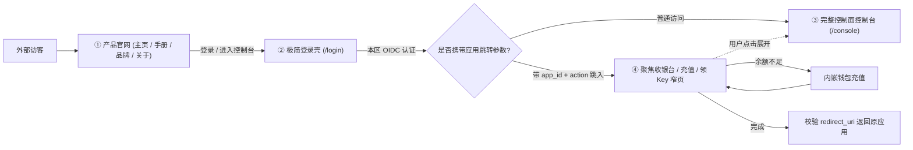

# 归一（UniHub）UI 设计规格书（终稿冻版 · v5.1）

- **状态**：已审核定稿（2026-11-28 · v5.1 冻版）
- **关联方案**：`docs/architecture.md` · `docs/architecture-rationale.md` · `docs/superpowers/plans/2026-11-26-unihub-rebuild.md`（基线提交 `080d353`）
- **品牌资产来源**：`NeoMei/UniHub` 官方品牌资产（`docs/assets/unihub-logo-v1.png` · `docs/assets/unihub-icon-v1.png`）
- **交互原型**：[ui-prototype.html](./ui-prototype.html)

本文档作为 **归一（UniHub）阶段 2a–3 编码实施的 UI 与品牌设计基线**。

---

## 1. 产品定位与四种页面形态

归一（UniHub）不是某一个接入应用的业务工作台，而是 **四大后台服务的前台统一整合控制台**，同时向外部访客提供统一的产品官网与文档入口：

1. **统一用户管理与接入平台**（整合 Logto OSS + Stage 1 身份/账户/企业席位/应用接入）
2. **统一的钱包与商品购买、管理平台**（整合现金钱包 + 跨应用收银台 + 订单快照 + Lago OSS 账单）
3. **API Key 与模型目录管理平台**（整合新 LLMRouter 统一 Key + 同源 `/v1/models` 目录）
4. **计费与账务平台**（整合 `src/billing/` 积分总账、预扣状态机、三层计量对账与运营发布）

“接入应用（如 SuperWagie / DocFlow AI）”在归一（UniHub）中作为**商品、API Key、席位与积分池的归属和筛选维度**，以及**外部应用带参跳入后回跳的会话上下文**。

为兼顾“外部认知与文档查阅”、“开发者/企业管理员全量管理”以及“终端用户从接入应用跳转完成支付/充值/领 Key”四类场景，归一（UniHub）提供 **四种视图形态**：

---

## 2. 已定稿的设计决策

| 决策项 | 定稿方案 | 对应需求出处 |
| --- | --- | --- |
| **外部应用跳入形态** | 收起左侧导航栏，进入居中 **单页聚焦模式**（保留付款账户切换、余额不足内嵌充值与「返回 `<App>`」主按钮），右上角提供「展开完整控制台」。 | 钱包与充值回跳体验 |
| **「应用接入」权限分层** | 用户门户仅展示 **「我授权过的应用」**（含首次授权时间与撤销授权）；应用登记、`redirect_uris`、一次性 `clientSecret` 与运营授权仅放在 **平台运营后台**。 | Stage 1 权限边界 |
| **小额积分展示精度** | 账本按百万分之一积分（整数）存储；门户默认展示 **2 位小数**，当 `0 < \|值\| < 0.01` 时自动展开至 **4 位小数**（如 `0.0040 积分`），所有积分数字悬停或详情可回读原始账本整数单位。 | `080d353` 精度要求 |
| **多路由模型目录报价** | 同计量单位多路由展示 **价格区间**（如 `0.10 ~ 0.12 积分`），跨单位能力（如 `qwen3-vl-embedding`）分项列示；网关调用前按选中路由锁定本次最高预扣，自动切换不得抬高已授权上限。 | `architecture.md` 目录定价 |
| **支付通道实现基线** | **直接继承原 `NeoMei/UniHub` 项目中已实现并验证通过的支付通道与回调验签模块**（含原收银拉起与幂等入账逻辑），在阶段 2b 中叠加新 UniHub 的 `deployment_region + currency` 错配拦截与钱包结账回跳闭环。 | 既有项目资产继承 |
| **品牌白标与内外术语隔离** | **所有对客界面（登录壳、用户/企业门户、聚焦收银台、商品描述文案）严禁露出内部开源组件名（Logto / LLMRouter / Lago）或开源合规声明弹窗**，统一使用 UniHub 品牌与通用业务术语；底层组件名及 **「开源合规声明与 NOTICE」** 统一收拢至 **平台运营后台** 管理（对外合规履行可按需通过独立 API 文档页承接，不污染门户界面）。 | 统一品牌体验 |
| **模型接入与计费口径（全部拍板）** | ① **全模型均通过第三方云 API 接入，系统不部署本地推理模型**（含 PaddleOCR 文档解析采用百度智能云等托管 API 渠道按页官方口径计费）；② 首期模型定价按 `应用 × 个人/企业版 × 账区 × 模型` 四维配置，不按会员档位区分单价；③ 积分不足覆盖请求上限时**直接拒绝并提示加购积分包**（不做自动裁剪 `max_tokens`）。 | 2a / 3 阶段拍板定稿 |
| **退费、企业周期与续费口径（全部拍板）** | ① 钱包未消费充值余额首期由**客服/运营核实后走原支付通道原路退回**，已购会员/积分包不支持现金退款（个人升级按公式折算退回原钱包）；② 企业成员周期上限按**该应用企业订阅的发放周期**统计（跨月在途归原周期）；③ 自动续费到期前 **3 天**提醒，期间商品涨价**需用户重新确认授权**，余额不足保留权益至当期结束、不发下期积分。 | 2b / 2c 阶段拍板定稿 |
| **生产前端工程选型（拍板）** | 阶段 2a–3 生产前端采用 **React + Vite + Tailwind 本地构建打包**，由 UniHub 静态托管，严格遵循 Stage 1 安全响应头与 CSP（零公网 CDN、零内联事件、写操作统一携带 `X-CSRF-Token`）。 | 前端工程基线 |

---

## 3. 页面级信息架构、路由与 API 映射

### 3.0 产品官网与对外信息页（Public Site · 全站严格白标，不露出底层开源组件名）

顶栏固定放置 **归一（UniHub）横版 Logo**、3 个主导航入口（`产品主页`、`使用手册`、`关于我们`）、本区只读标识，以及「登录 / 进入控制台」主 CTA；**「品牌规范（`/brand`）」不占用顶部主菜单，统一收拢在官网与用户门户页底链接区**；控制台顶栏亦保留直达「产品主页 · 使用手册 · 关于」的轻量链接：

| 页面名称 | 建议路由 | 核心区块与目标 | 转化与联动 |
| --- | --- | --- | --- |
| **产品主页** | `/` | ① Hero 主视觉（“让多款 AI 产品围绕同一账户协作”+ 立即登录/查看手册 CTA）；② 四大核心能力卡（统一身份与企业席位、现金钱包与订阅套餐、按应用隔离的 API Key 与模型目录、透明积分账本与对账）；③ 接入生态示例（SuperWagie / DocFlow AI 等）；④ 双区独立部署说明（`cn/CNY` 与 `us/USD` 账区数据与结算隔离） | 一键进入登录壳或控制台、跳转使用手册 |
| **使用手册** | `/docs` | 左侧章节目录 + 右侧正文与可复制代码片段：① **快速上手**（注册登录、个人/企业付款账户切换、首次充值）；② **钱包、套餐与积分规则**（立即升档与折算公式、积分批次先到期先扣、极小额精度展示）；③ **API Key 与模型调用**（按应用签发 Key、OpenAI 兼容 `/v1` 端点调用示例、多路由区间价）；④ **接入应用集成指南**（`/login` 交接参数、后端 HTTP Basic `/api/apps/login/exchange` 换码流程与安全约束） | 章节内直达对应控制台功能页 |
| **品牌规范** | `/brand` | 面向接入应用开发者与合作方的官方视觉指南：① **中英文标准命名**（中文「归一」、英文 `UniHub` 严格区分大小写、双语「归一（UniHub）」）；② **Logo 与应用图标预览及下载**（`unihub-logo-v1.png`、`unihub-icon-v1.png`，含浅色底与深色底 `#F3F8FA` 圆角承托底板示范）；③ **官方色板**（点击复制 HEX）；④ **使用禁区与白标原则**（禁止拉伸变形、更改字体、加投影，禁止在用户侧露出底层开源依赖） | 提供官方 PNG 资源直接下载 |
| **关于我们** | `/about` | ① 产品定位与愿景（为什么打造归一统一账户与计费中枢）；② 三大核心原则（账务透明可核对、个人与企业权责清晰、双区独立合规运行）；③ 联系与技术支持入口（商务接入、技术工单、安全反馈） | 跳转登录、使用手册或品牌规范 |

### 3.1 用户 / 企业门户（Portal · 统一挂载于 `/console/*`，分组扁平侧栏，取消页内冗余二级 Tab）

为避免与官网根路径 `/` 冲突，同时避免“编号二级 Tab 容易误解为流程步骤”，用户/企业门户统一挂载在 `/console/*` 下（登录成功默认跳转 `/console`），采用 **「4 组主题分组 + 单击直达独立页面」** 结构，顶栏常驻「当前付款账户切换」与 **「+ 创建企业」（`POST /api/accounts/enterprises`）** 入口：

| 侧栏分组 | 一级导航菜单 | 建议路由 | 核心区块与交互（单页直达，无二级 Tab） | 对接后端阶段与接口 |
| --- | --- | --- | --- | --- |
| *(置顶独立入口)* | 账户总览 | `/console` | 当前付款账户、现金钱包、有效 Key、积分用量 4 张核心状态卡 + 各应用权益积分池 + 最近交易与结算 | Stage 1 `GET /api/session`、`POST /api/session/account`、`POST /api/accounts/enterprises` + 2b/3 聚合查询 |
| **账务与购买** | 钱包与充值 | `/console/wallet` | **顶部余额卡**（账户名 + 可用现金 + 币种 + 右上角「充值」）、可原路退款余额（首期提示由客服/运营核验后走原支付通道原路退回，或在 2b 拍板后按原充值单开放自助退款申请）、拒付欠款冻结提示、结账回跳条、现金流水与收款凭证 | 2b 钱包与支付回调 |
| | 套餐与积分包 | `/console/shop` | 跨应用已上架商品卡（按应用筛选，自动匹配个人/企业版），明确区分 **`当前方案`**（不可重复购）、**`立即升档（支持折算）`**、**`加购积分包`** 与 **`立即购买 / 增购席位`** 动作语义；内置个人升级折算试算器、收银台弹窗与 **余额不足保留上下文跳充值再返回** | 2a 商品版本 + 2b/2c 订单与升级折算 |
| | 订阅与订单 | `/console/orders` | 跨应用有效订阅与自动续费管理（含 **「已预约下周期变配」待生效状态条**：展示个人降档/年转月或企业减席/换档的目标方案、生效日与「取消预约」按钮）+ 历史订单成交快照回读 + 企业账单 PDF 下载 | 2b/2c 订单 + 按需企业出账同步 |
| | 积分与调用明细 | `/console/usage` | **同屏上下两区**：上方为有效积分批次（按 `expires_at ASC, batch_id ASC` 优先扣减及守恒列示），下方为逐笔调用扣费流水（状态徽章 + 三列计价依据 + 极小额 4 位展开与原值悬停回读） | 2b 积分账本 + 3 预扣与结算明细 |
| **应用与模型** | API Keys | `/console/keys` | 品牌反代网关接入端点（`/v1` Base URL 与多模态/OCR 根入口）、**按绑定应用筛选与分组管理 Key**（各应用卡片独立展示本应用席位/签发权限、专属签发入口及跳转该应用模型）、签发选择目标应用（一次性明文弹窗）、轮换、吊销、席位撤销失效态 | 3 网关内网 Key 接口 |
| | 模型与价格 | `/console/models` | **按指定应用切换**的 `/v1/models` 同源过滤目录（明确展示 `应用 × 付款账户类型 × 账区` 过滤维度，多路由区间价与跨单位分项价，无席位拦截提示） | 2a 目录发布 + 3 网关交集过滤 |
| **组织与账号** | 企业成员与席位 *(仅企业账户可见)* | `/console/enterprise` | 一次性邀请链接、成员角色与 `canRecharge / canPurchase` 权限、**按应用独立分配席位**、成员周期上限、企业增席补差试算（个人账户隐藏此入口，避免空状态误导） | Stage 1 `/api/accounts/:accountId/members` + 2b 应用席位与邀请契约 |
| | 账号安全与授权 | `/console/security` | **同屏上下两区**：上方为账号信息、修改密码/MFA、服务端会话撤销与退出登录；下方为「我授权过的应用」与撤销授权 | Stage 1 `POST /logout` + **2a/2b 需补齐新增**：`GET/DELETE /api/me/authorized-apps` |

### 3.2 平台运营后台（Operator Admin · 与门户同构：分组扁平侧栏 + 零页内冗余 Tab + 按角色裁剪）

> **设计同构、上下文隔离与角色裁剪**：完全沿用用户门户的「置顶总览 + 3 组扁平侧栏 + 单页只做一件事（零页内二级 Tab）」信息架构；**运营后台顶栏隐藏「当前付款账户」选择器与「+ 创建企业」按钮**，改为只读的「运维角色 + 权限范围」标识，避免与用户付费上下文混淆。① **平台管理员（`UNIHUB_OPERATOR_SUBJECTS`）** 可见置顶「运营总览」及 3 组共 7 个独立页面；② **单应用商品运营（`app_operators`）** 仅可见「应用与商品（已授权）」下的 2 个核心配置页（`商品卡配置`、`模型路由与售价`），且应用下拉列表严格收敛到其被授权应用，不暴露全局总览、接入应用登记、账务对账与系统/支付对接。历史不可变版本快照直接收拢为页头「历史版本 (N)」弹窗，不额外占用侧栏菜单。

| 侧栏分组 | 一级导航 | 建议路由 | 核心区块与交互（单页直达，无二级 Tab） | 权限与后端接口边界 |
| --- | --- | --- | --- | --- |
| *(置顶独立入口)* | **运营总览** | `/admin` | 已接入应用数、本区现金/积分守恒、TTL 挂起预扣、子系统与支付健康 4 张状态卡 + 待处理运维事项 + 常用后台快捷入口 | 平台管理员 (`UNIHUB_OPERATOR_SUBJECTS`) |
| **应用与商品** | **接入应用管理** | `/admin/apps` | **全流程应用接入管理**：① 应用列表与上线就绪度（回调数 / 运营人数 / 已发布版本数）；② **4 步新应用登记向导**（基础信息与实时 `redirect_uris` 合规校验 → 一次性签发与确认 `clientSecret` → 指派 `app_operators` → 生成联调代码与上线清单）；③ **应用详情与维护页**（启停应用、修改回调失效未用登录码提示、轮换 `clientSecret`、运营授权、回调白名单模拟检测器） | 平台管理员 · Stage 1 已有 `POST /api/admin/apps`、`GET/PUT /api/admin/apps/:appId`、`PUT/DELETE .../operators/:userId`；**2a/2b 需补齐新增**：`GET /api/admin/apps`、`POST .../rotate-secret` |
| | **商品卡配置** | `/admin/apps/:appId/products` | **多卡同屏管理 + 单卡独立上架 / 更新上架 / 下架（防误上其他草稿）**：选定 `应用 × 个人/企业版` 后，顶部状态条展示当前线上生效版本 ID、未上架/待更新卡数与 `全部 / 已上架 / 未上架/待更新` 筛选，页头提供「历史版本 (N)」弹窗回读任意不可变快照（**取消页面级全局发布按钮**）；每张商品卡清晰标示 **`已上架`** / **`有修改 · 待更新`** / **`未上架`** / **`已下架`**，并直接在卡片右下角与预览卡底部提供 **「上架」 / 「更新上架」 / 「下架」 / 「重新上架」** 按钮——单卡上架/下架时自动合入当前线上生效集生成新的不可变版本，确保其他未完成草稿严格隔离不误上架，且下架仅停止新购不影响历史已购订单权益；同时支持 `+ 新增会员卡` / `+ 新增积分包`、按 `rank` 自动排序、复制、删除、「整版货架预览」及 A/B/C 三区编辑预览 | 平台管理员 / 该应用授权运营 (`app_operators`) |
| | **模型路由与售价** | `/admin/apps/:appId/routes` | **全项可配置 + 页内区分已发布/草稿**：按 `应用 × 个人/企业版 × 账区` 独立配置：① 金额换积分比例 (`credits_per_currency`)、生效时刻 (`effective_at`) 与页内已发布/未发布状态条及「历史版本」弹窗；② 从 LLMRouter 拉取可路由模型列表，逐条开关目录可见性与允许预扣；③ 锁定每条路由的 `meter_version / router_rate_version`（网关有新版本时提示显式「升级锁版」，防网关改价静默影响用户）；④ 编辑二层售价系数（溢价/折扣）与可选权益过滤键 (`entitlement_filter`)；⑤ 实时重算对客积分与最小计费粒度账本单位（归零时阻断发布）并预览落库 JSON 快照 | 平台管理员 / 该应用授权运营 (`app_operators`) |
| **账务与对账** | **账务核对与巡检** | `/admin/reconciliation` | **同屏多区**：上方 4 张守恒与指标卡 + 「TTL 巡检挂起队列 (`reconciling`) 与平台超额成本差异台账」（支持反查网关证据与标记路由上限核查）+ 「Lago OSS 异步出账同步队列」（支持核对账单快照与幂等补推） | 平台管理员 / 财务运营 |
| **系统与支付** | **子系统对接** | `/admin/integrations/subsystems` | **不替代子系统原生后台**，严格区分 **「环境变量/密钥挂载（只读回显 + 探活）」** 与 **「非密钥运行配置（支持热更新）」**：① 部署区运行基线（`UNIHUB_REGION/CURRENCY`、`billing_timezone`、`UNIHUB_OPERATOR_SUBJECTS` + Nginx 品牌反代模板）；② Logto OSS（`LOGTO_ISSUER`/`CLIENT_ID`/`SECRET` 只读 + OIDC 探活）；③ 新 LLMRouter（热更新对客反代根地址、内网端点、兼容 `gateway_version`、TTL、`fx_policy`、AGPL 源码地址）；④ Lago OSS（按需启停开关、开源样张测试）及「开源合规声明与 NOTICE」 | 平台管理员 (`UNIHUB_OPERATOR_SUBJECTS`) |
| | **支付渠道配置** | `/admin/integrations/payments` | 独立一页管理本区收款通道（**继承原 `NeoMei/UniHub` 已验证支付与验签模块**，证书/私钥只读挂载 + 启停/场景热更新 + 配置自检）：国内服并排展示 **微信支付 v3**（AppID、MchID、证书序列号、APIv3/私钥/平台公钥挂载态、Notify URL）与 **支付宝**（AppID、RSA2 证书模式、私钥/公钥挂载态、Notify/Return URL）；美区服展示 **Stripe**（Publishable Key、Account ID、Secret/Webhook 挂载态、Webhook URL） | 平台管理员 (`UNIHUB_OPERATOR_SUBJECTS`) |

### 3.3 外部应用跳入聚焦模式（`/handoff`）与企业邀请认领页（`/invite/:token`）

均采用**居中窄页无侧栏**布局，顶部保留归一（UniHub）图标与来源/状态徽章，右上角提供「展开完整控制台」：

| 入口路由 | 入参契约与前置校验 | 页面交互与异常状态 |
| --- | --- | --- |
| **`/handoff`** 外部应用聚焦交接 | 查询参数：`app_id`（必填）、`action`（`checkout` \| `recharge` \| `issue_key`）、`redirect_uri`（必填，须逐字命中已登记白名单）、可选 `sku_id` / `tier_id`、`state`；服务端强制校验应用启用态、本区 `region` 及登录会话（未登录先走 `/login` 后回跳）。 | ① **`action=checkout`**：单页收银台（付款账户切换 + 升级折算透明展示 + 余额不足内嵌直充后自动回跳确认 + 完成后「返回 `<App>`」）； ② **`action=recharge`**：单页直充（确认付款账户与金额 + 调起本区支付通道 + 入账后展示回执并「返回 `<App>`」）； ③ **`action=issue_key`**：单页领用该应用 API Key（校验当前账户本应用席位/权限 + 一键签发并弹出一次性明文 Key 确认 + 「返回 `<App>`」）。 |
| **`/invite/:token`** 企业一次性邀请认领 | 路径参数：一次性邀请令牌 `token`（服务端校验有效期、未消费状态与所属 `deployment_region`）。 | ① **有效邀请**：展示目标企业名称、邀请人、预设成员角色与有效期；未登录引导登录后回到本页，已登录点击「确认加入企业」后自动切入该企业上下文（并提示管理员分配各应用席位）； ② **异常态**：明确区分「邀请链接已过期」「链接已被认领」「所属部署区不匹配（cn/us 隔离）」，提供返回控制台或联系企业管理员引导。 |

---

## 4. 关键业务闭环交互规范

1. **结账余额不足 → 钱包充值 → 回跳原结账页**：
   - 用户点击购买后，收银台实时比对当前付款账户现金余额与商品售价（个人升级按新套餐全价校验）。
   - 余额不足时，点击「余额不足，去充值」持久化 `pendingCheckout`（原商品、版本、应用与付款账户），进入「钱包 → 充值」并自动预填差额（向上取整）。
   - 支付回调入账后，在钱包顶部展示「充值已到账，回到原结账确认页」（聚焦模式下直接自动切回结账确认卡片），由用户显式二次确认付款。
2. **个人套餐升级折算透明展示**：
   - 升级确认页明确列出：**新套餐全价**、**预计旧套餐折算返还**（区分“升级确认立即返还”与“在途预扣终结后补返差额”）、**预计净支出**。
   - 遵循统一公式 `最终累计返还 = min(C, F + floor(P × max(0, B - U) / B))`，赠送积分与独立积分包不计入折算。
3. **企业按应用分配席位与增减席**：
   - 成员权限表按应用并列展示席位开关，单次分配/撤销同事务校验已购席位数防超配；撤销应用 A 席位时，应用 B 席位独立生效。
   - 增席对齐原订阅到期日，界面实时试算剩余天比例补差与当期共享池补发积分；减席与换档提示在下一续费边界生效。
4. **API Key 一次性安全展示与撤权态**：
   - 签发或轮换 Key 成功后弹出一次性明文弹窗（提供复制与“我已妥善保存”确认），关闭后列表仅展示前缀与绑定上下文。
   - 当企业成员被移除或单应用席位被撤销时，对应 Key 标记为「席位撤销已失效」，网关即时拒绝新调用。
5. **单卡独立上架/下架与不可变版本快照映射（阶段 2a 实现契约）**：
   - 运营后台在 `product_drafts` 维护每张卡片的编辑草稿与状态（`未上架` / `已上架` / `有修改 · 待更新` / `已下架`）；
   - 点击某张卡的「上架 / 更新上架 / 下架」时，服务端在单个事务内将 **「当前线上已生效卡集 ± 该卡最新配置」** 固化生成一条新的不可变 `commerce_version` 快照并切为生效版本，其他未上架草稿严格保留在草稿表、不随本卡误上线；历史订单与在途计费按原版本 ID 回读不受影响。
6. **登记接入应用全流程（`/admin/apps`）**：
   - **Step 1 基础信息与回调白名单**：输入 `name`（1–160 字符）、`enabled` 及 1–20 条 `redirect_uris`；前端实时执行与后端 `src/apps.js` 一致的严格校验（仅允许 `https://` 或回环 `http://localhost|127.0.0.1|[::1]`，禁止用户名/密码、`#` 片段及预设 `code`/`state` 参数）。
   - **Step 2 一次性签发 `clientSecret`**：提交 `POST /api/admin/apps` 后仅在本步展示一次明文 `clientSecret`（服务端只存 SHA-256 摘要），须勾选安全交付确认后才可离开本步；明确提示应用凭证仅用于后端 `login/exchange`，与终端用户模型 API Key 严格分离。
   - **Step 3 授权单应用商品运营（`app_operators`）**：按 UniHub 用户 ID/邮箱增删该应用的运营人员（`PUT`/`DELETE /api/admin/apps/:appId/operators/:userId`），实现单应用最小权限隔离。
   - **Step 4 联调代码与上线就绪衔接**：自动生成带当前 `app_id` 和白名单回调的 `GET /login` 跳转链接及 `POST /api/apps/login/exchange` HTTP Basic 示例（2 分钟一次有效），提供一键跳转「商品与定价发布」完成首发商品配置。
   - **日常运维与变更保护**：在应用详情页修改/删除回调或停用应用（`PUT /api/admin/apps/:appId`）时，界面显式提示“关联未使用的登录码将立即失效”，并内置「回调地址合规与白名单模拟检测器」辅助排障。

---

## 5. 角色与权限矩阵

| 操作 / 入口 | 个人账户 | 企业所有者 | 企业管理员 | 企业普通成员（有应用席位） | 企业普通成员（无应用席位） |
| --- | :---: | :---: | :---: | :---: | :---: |
| 切换付款账户 / 切回个人 | ✓ | ✓ | ✓ | ✓ | ✓ |
| 查看企业现金余额与充值 | ✓（本人） | ✓ | 需 `canRecharge` | 需 `canRecharge` | 需 `canRecharge` |
| 购买应用会员 / 席位 / 积分包 | ✓ | ✓（无席位可买首批） | 需 `canPurchase`（无席位可买首批） | 需 `canPurchase` | ✗（引导联系管理员或切个人） |
| 领用该应用 API Key / 消费 | ✓ | 需持有该应用席位 | 需持有该应用席位 | ✓ | ✗（他应用席位独立生效） |
| 管理企业成员、分配席位、生成邀请 | — | ✓（含管理员） | ✓（仅普通成员，不越权） | ✗ | ✗ |
| 账户欠款/拒付冻结时 | 冻结新购与新预扣；在途已受理任务继续按原预扣结算；顶部强提示补足 | 同左 | 同左 | 同左 | 同左 |

---

## 6. 视觉、品牌识别与工程实现规范（衔接 `NeoMei/UniHub` 与 Stage 1）

1. **安全、CSP 与生产前端工程约束**：
   - 沿用 Stage 1 `src/app.js` 严格安全响应头（`cache-control: no-store`、`frame-ancestors 'none'`、`X-CSRF-Token` 写操作保护）；表单与写入 API 均需携带 CSRF 令牌。
   - **`ui-prototype.html` 仅为单文件交互原型**（内含演示用外链样式脚本与内联 `onclick`）；**生产前端实现必须本地打包静态 CSS/JS 资源，严禁依赖公网 CDN、严禁使用内联 `onclick="..."` 等违反严格 CSP 的写法**，统一通过事件委托或现代前端框架模块绑定事件。
2. **官方品牌识别（承接 `NeoMei/UniHub` 品牌规范）**：
   - **命名规范**：中文「**归一**」，英文 `UniHub`（严格区分大小写），中英并列统一写作「**归一（UniHub）**」；副标题可用「统一身份与账户中心」「统一用户与计费平台」「让多款 AI 产品围绕同一账户协作」。
   - **标志资产**：统一使用官方横版标志 `docs/assets/unihub-logo-v1.png`（导航栏、官网顶栏、登录壳、聚焦收银台）与应用图标 `docs/assets/unihub-icon-v1.png`（Favicon、移动端/紧凑卡片），严格保持原比例与四周留白，禁止拉伸、改字或加投影；在深色背景上展示横版 Logo 时，必须外包 `#F3F8FA` 柔和圆角底板（`border-radius: 8px; padding: 4px 6px`）。
   - **基础排版**：侧栏宽度 `232px` 纯白底（`#FFFFFF`），页面主画布使用浅雾白（`#F3F8FA`），卡片纯白底配 `1px solid #DEE8EC` 细边框；所有金额、积分、版本号、请求号、Key 前缀统一使用等宽数字（`font-variant-numeric: tabular-nums`），最小字号 `12px`。
3. **官方色板与语义色规范**：
   - `Primary Teal (#087F8C)`：主操作 CTA、激活导航指示条、品牌核心强调色
   - `Brand Mint (#35C4A3)`：品牌渐变辅色、生态亮点、次级视觉点缀
   - `Deep Ink (#142B35)`：一级标题与正文主文字色
   - `Muted Slate (#6C8290)`：次要说明、分组标题、元数据文字
   - `Soft White (#F3F8FA)` & `Border (#DEE8EC)`：全局底色与细分隔线
   - `Success (#15803d)`：`settled` 已结算、已分配席位、充值到账、平账守恒
   - `Warning (#b45309)`：`reconciling` 巡检核查、在途预扣、临期优先扣减批次、一次性密钥安全提醒
   - `Error (#b91c1c)`：欠款冻结、余额不足、席位撤销失效 Key、撤权拦截
4. **双区视觉防错与高危操作二次确认**：顶栏与页脚常驻只读部署区标识（`cn / CNY (¥)` 或 `us / USD ($)`），支付渠道与币种严格随 `deployment_region` 绑定；全站对客统一使用 **`API Key`** 命名（不再混用 `Token Key`）；对 **商品卡下架 / 删除、API Key 吊销、企业成员移除 / 撤销席位** 等高影响操作统一提供轻量二次确认弹窗防误触；登录壳仅展示对客自然文案并提供「← 返回产品主页」入口。
5. **货架预览口径**：后台「商品卡配置 → 整版货架预览」默认仅展示用户端实际可见的 **已上架** 卡片，支持按需勾选「同时预览未上架/待更新卡片」（以虚线边框与状态徽章显著区分）。
6. **开源合规管理入口**：将「开源合规声明与 NOTICE（AGPL-3.0 网关运行版本源码与署名核对）」统一收拢在 **平台运营后台**（子系统对接页及运营后台页脚），不在官网及用户/企业门户页脚露出；对外网络用户告知义务可按需由独立 API 文档页承接。
